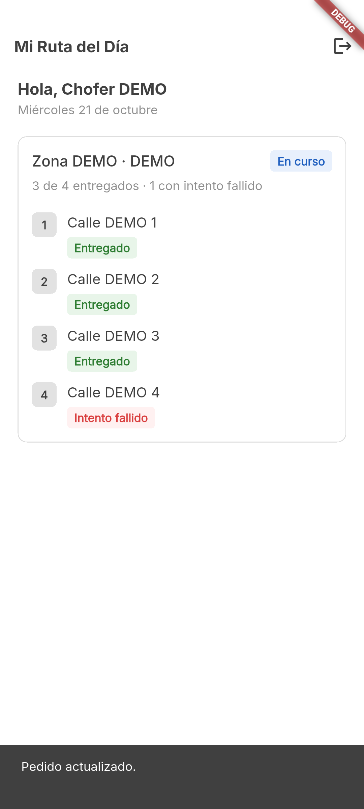

# Issue #3 — Mi Ruta del Día

Fecha: 21 de octubre de 2026 (America/Guayaquil).

## Alcance

- GET autenticado `/drivers/me/routes?date=YYYY-MM-DD`, con fecha de Ecuador e identidad desde JWT.
- Zona, estado, direcciones y orden de paradas; carga, error, reintento, lista vacía y actualización manual.
- PATCH `/orders/:id/status` para IN_TRANSIT y DELIVERED, solo en ruta IN_PROGRESS; bloqueo de botones mientras se espera respuesta.
- Refresco tras guardar, rechazo sin confirmación falsa y conservación de la lista ante error de recarga.
- Resultado histórico SUCCESSFUL/FAILED separado del estado comercial actual. Tres visitas exitosas y una fallida muestran 3 de 4 entregados.

Los cambios visuales de bienvenida/login, tipografía Inter y preferencia de inversión de colores ya estaban presentes en el trabajo local; se conservan con sus pruebas. El inicio desde la interfaz corresponde a #4; el formulario de fallo y el regreso al depósito corresponden a #8.

## Validación automatizada

`flutter pub get`: correcto. `flutter analyze`: sin problemas. `flutter test`: **60 pruebas aprobadas**.

Las pruebas de unidad/widgets cubren orden, fechas UTC-5, estados vacíos/error, Bearer, transiciones, 401/403/409/500, timeout sin reenvío automático, bloqueo de botones, fallo del GET posterior y resultados históricos después de reprogramación.

## Integración Android

Resultado: **PASS**, salida 0 de `flutter drive`. Escenario de integración completo aprobado en el emulador `Medium_Phone_API_36.1`, Android API 36, x86_64. El intento en teléfono físico no llegó a ejecutar el test por pérdida de la conexión USB; no se declara validado en ese dispositivo.



Compilación debug de integración: `build/app/outputs/flutter-apk/app-debug.apk`, Flutter 3.41.3 / Dart 3.11.1, JDK 17. SHA-256: `65e4b718e1c1c6ab595c1963ab7775617663ecfd52277d17eb689a3bb156d764`. Es el APK de pruebas, no un artefacto de distribución de #6.

La integración usa cuentas `@fixture.invalid`, direcciones Calle DEMO y una base exclusiva `mobile_issue3_<sufijo>`. Copia solo el esquema de PostgreSQL; nunca copia datos del usuario. El puerto 3003 aloja el backend de prueba. La prueba rechaza cualquier otra URL para evitar mutaciones accidentales.

Verifica con REST real: dos conductores ven rutas distintas; ADMIN y CLIENT reciben 403; sin JWT recibe 401; un conductor ajeno no puede modificar el pedido; los botones de Flutter actualizan tres entregas y consultan sus resultados persistidos; una visita fallida se muestra sin DELIVERED/CANCELLED falsos.

Backend local validado: `13a557e3871895d93a43f40ab81f7a8e55dec012`.

Respuesta persistida final: ruta IN_PROGRESS; estados de pedidos `DELIVERED, DELIVERED, DELIVERED, ASSIGNED`; resultados de visita `SUCCESSFUL, SUCCESSFUL, SUCCESSFUL, FAILED`. La ruta no se completa desde esta prueba: el flujo de cierre/retorno se desarrolla en #8. El inicio y el registro de fallo se invocan como preparación del escenario, sin implementar todavía esos botones en el producto.

## Reproducción en PowerShell

Requiere el repositorio backend con dependencias instaladas, Node 26, PostgreSQL local en el contenedor `logistica_postgres` con el esquema actualizado, Flutter, JDK 17 y un Android conectado. Los valores locales de Docker se corresponden con el compose de desarrollo del backend.

```powershell
# Desde el backend, antes de iniciar la fixture:
npm run build

# Desde AppRepartidor; escoger un nombre único por ejecución:
node tool/daily_route_fixture.mjs setup ../BackendRepartidor/backend mobile_issue3_prueba_unica
node tool/daily_route_fixture.mjs serve ../BackendRepartidor/backend mobile_issue3_prueba_unica
```

En otra terminal, desde AppRepartidor:

```powershell
& C:/Android/Sdk/platform-tools/adb.exe -s <device-id> reverse tcp:3003 tcp:3003
flutter drive --driver=test_driver/integration_test.dart --target=integration_test/daily_route_test.dart -d <device-id> --dart-define=API_BASE_URL=http://127.0.0.1:3003/api/v1
```

El driver guarda `android-daily-route.png` en esta carpeta. La contraseña constante de fixture es ficticia y sirve exclusivamente para esta base de prueba; el test no imprime JWT ni contraseñas.

Detener el servidor de fixture con Ctrl+C antes de limpiar:

```powershell
node tool/daily_route_fixture.mjs cleanup ../BackendRepartidor/backend mobile_issue3_prueba_unica
& C:/Android/Sdk/platform-tools/adb.exe -s <device-id> reverse --remove tcp:3003
```
