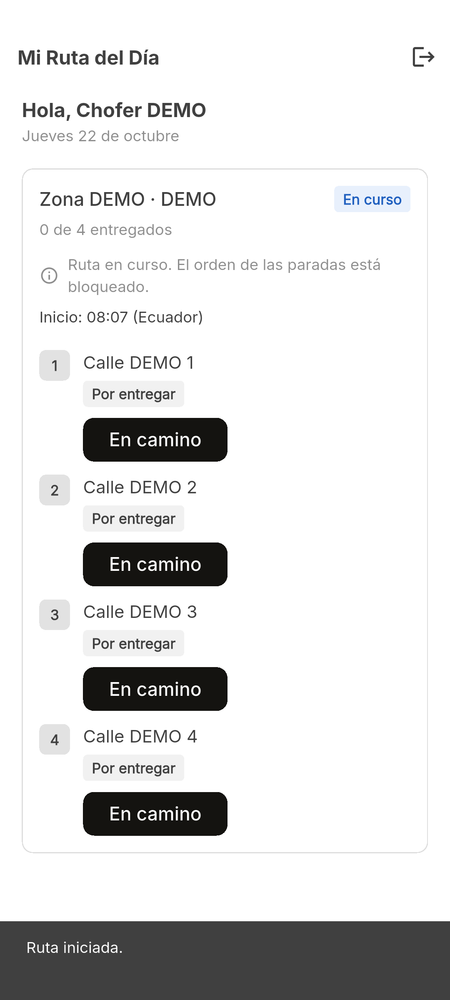
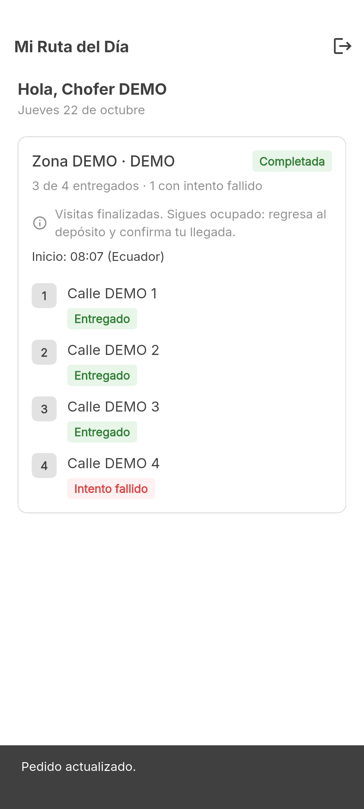

# Issue #4 — Iniciar ruta

Fecha: 22 de octubre de 2026 (America/Guayaquil).

## Comportamiento

- «Iniciar ruta» aparece exclusivamente para DRIVER y rutas ASSIGNED obtenidas por GET autenticado de rutas propias. La propiedad y autorización se verifican en backend.
- POST `/api/v1/routes/:id/start`, JSON `{}`, con Bearer. Se valida que la respuesta confirme la misma ruta, IN_PROGRESS y una hora con zona horaria.
- Mientras se espera se bloquean inicio y actualizaciones de pedidos. El doble toque no duplica el POST.
- El estado y la hora de inicio (Ecuador UTC-5) cambian tras confirmación REST. Se conserva el orden de las paradas y no hay controles de edición/reordenamiento.
- Una pérdida de respuesta provoca consulta GET, nunca reenvío automático de POST. Si GET también falla, otro intento requiere actualización previa. Una respuesta GET anterior al inicio no revierte el estado confirmado.
- Los rechazos no anuncian éxito. Un 401 con sesión activa borra la sesión y muestra el aviso una vez en el login; 403 informa falta de permiso; 409 informa estado incompatible.
- COMPLETED distingue visitas exitosas/fallidas y muestra retorno pendiente mientras `returnedAt` no esté confirmado. No presenta AVAILABLE por deducción. Si existe retorno persistido, muestra su confirmación sin afirmar disponibilidad actual.

El formulario de fallo, la acción de completar visitas y la confirmación de retorno corresponden a #8. La integración usa esas APIs solo para preparar el estado de lectura COMPLETED.

## Pruebas de unidad y widgets

- `flutter pub get`: correcto.
- `flutter analyze`: sin problemas.
- `flutter test`: **96 pruebas aprobadas**.

Incluyen inicio correcto, doble toque con respuesta pendiente, repetición con hora original, respuesta incompleta/de otra ruta, 400/401/403/404/409/500, timeout sin duplicación, recuperación GET, GET fallido posterior al POST, respuestas GET fuera de orden, cierre de sesión real en el widget raíz y estados que no permiten iniciar. Se comprueba orden y resultados de visitas en una COMPLETED con fallo y retorno pendiente.

## Integración Android con API real

Resultado: **PASS**, `flutter drive` terminó con salida 0 y todas las comprobaciones aprobadas. Ejecutado en `Medium_Phone_API_36.1`, Android API 36, x86_64. No se declara validación en teléfono físico.





Build debug de integración: `build/app/outputs/flutter-apk/app-debug.apk`, SHA-256 `b2393a6963df168240df6cf9661eb0a561a9af03730d40fba7ef8ee505ef4b3c`. Corresponde al escenario de prueba, no a un APK de distribución.

Escenario: dos conductores y roles ADMIN/CLIENT ficticios; inicio ajeno y sin JWT rechazados; un doble toque produce un solo POST desde la UI. La prueba agrega una demora de transporte de 500 ms solo al primer inicio para observar el bloqueo; las respuestas REST y la persistencia son reales. Una repetición explícita posterior verifica idempotencia en backend y conserva `startedAt`.

Se entregan tres pedidos desde los botones Flutter, se prepara una visita fallida y se completa la ruta mediante la API. Se verifica orden conservado, 3 de 4 entregados, visita fallida distinguida, `returnedAt == null`, `isAvailable == false` y rechazo 409 de un nuevo inicio sobre COMPLETED.

Backend: `13a557e3871895d93a43f40ab81f7a8e55dec012`. PostgreSQL aislado, solo esquema copiado de desarrollo y filas ficticias nuevas; no se copian ni modifican datos existentes.

Consulta SQL directa posterior: ruta `COMPLETED`, inicio persistido, retorno sin confirmar y `driver.isAvailable = false`. Las paradas conservan secuencias 1–4; resultados `SUCCESSFUL, SUCCESSFUL, SUCCESSFUL, FAILED`; estados comerciales `DELIVERED, DELIVERED, DELIVERED, ASSIGNED`.

## Reproducción en PowerShell

Requisitos: Flutter 3.41.3 / Dart 3.11.1, JDK 17, Android, Node 26, repositorio backend con dependencias y build actualizados, PostgreSQL en `logistica_postgres` con el esquema del backend actualizado. Elegir un nombre único por ejecución.

```powershell
# Desde backend:
npm run build

# Desde AppRepartidor:
node tool/daily_route_fixture.mjs setup ../BackendRepartidor/backend mobile_issue4_prueba_unica
node tool/daily_route_fixture.mjs serve ../BackendRepartidor/backend mobile_issue4_prueba_unica
```

En otra terminal, desde AppRepartidor (ajustar ruta de adb y dispositivo):

```powershell
& C:/Android/Sdk/platform-tools/adb.exe -s <device-id> reverse tcp:3003 tcp:3003
flutter drive --driver=test_driver/start_route_test.dart --target=integration_test/start_route_test.dart -d <device-id> --dart-define=API_BASE_URL=http://127.0.0.1:3003/api/v1
```

El driver guarda las capturas en esta carpeta. La prueba solo admite la URL local de fixture; sus cuentas `@fixture.invalid`, contraseña constante y direcciones DEMO son ficticias. No imprime JWT ni contraseñas.

Detener el servidor de fixture con Ctrl+C antes de limpiar:

```powershell
node tool/daily_route_fixture.mjs cleanup ../BackendRepartidor/backend mobile_issue4_prueba_unica
& C:/Android/Sdk/platform-tools/adb.exe -s <device-id> reverse --remove tcp:3003
```
