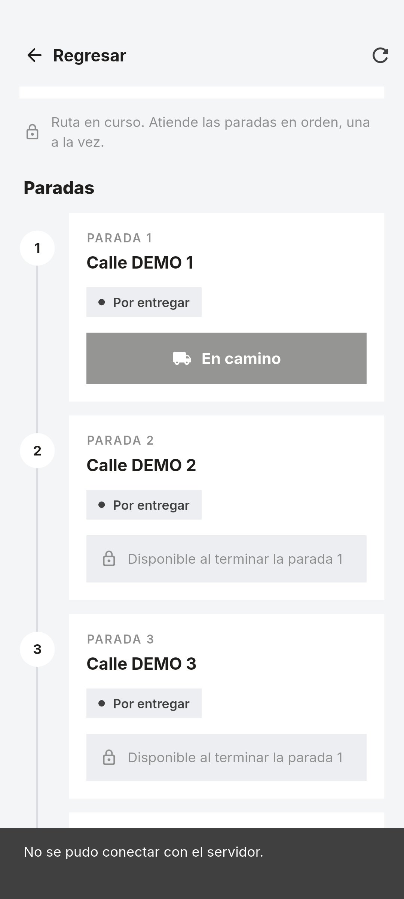
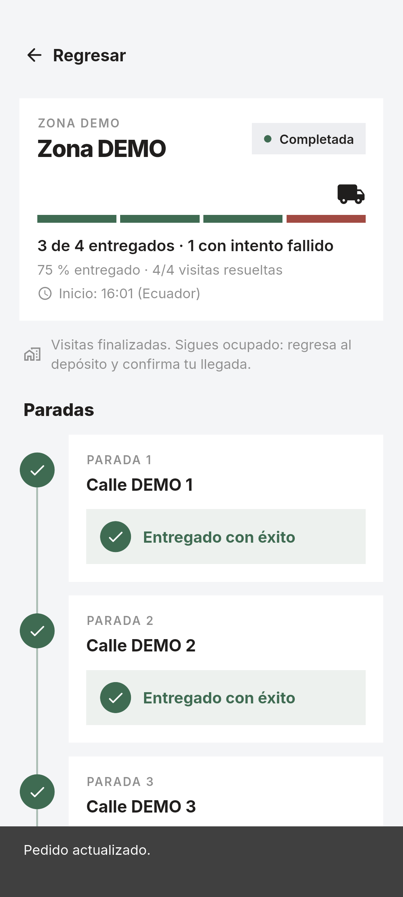
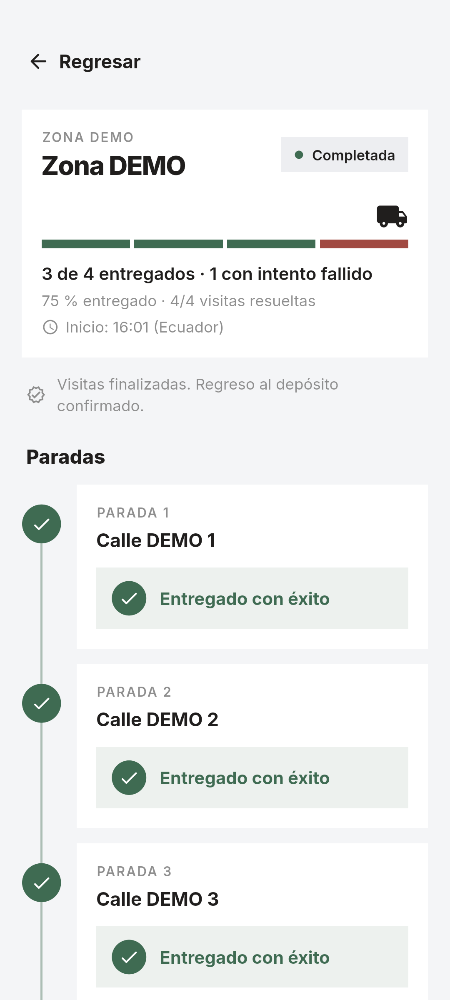

# Issue #5 — Progreso, errores y recuperación

Fecha: 27 de octubre de 2026 (America/Guayaquil).

## Comportamiento

- El porcentaje usa únicamente entregas exitosas persistidas: tres éxitos y un fallo muestran «3 de 4 entregados · 1 con intento fallido» y «75 % entregado · 4/4 visitas resueltas». La barra segmentada representa visitas resueltas; los fallos conservan su color y nunca suman al porcentaje de entregas. Una ruta vacía muestra 0 %, sin división por cero.
- Un PATCH pendiente bloquea el doble toque e invalida los GET anteriores. Solo se confirma la acción tras respuesta REST; tras timeout o pérdida de conexión se consulta GET, sin repetir el PATCH. El GET puede recuperar una entrega realmente persistida aunque su respuesta se haya perdido.
- Si tampoco se puede recuperar GET, se conserva la ruta consultada y se bloquean nuevas mutaciones hasta actualizar. También se bloquean si falla el GET posterior a un PATCH confirmado. El icono «Actualizar estado» y el gesto de recarga permiten recuperar; volver al primer plano consulta GET. Recuperar la red con la app en primer plano requiere actualizar manualmente: no hay observador de conectividad, sondeo ni cola offline.
- Respuestas de rutas con estructura inválida muestran un error recuperable y conservan los datos anteriores. Los errores 400/403/409 no anuncian éxito; 401 elimina la sesión y vuelve al login. Los errores de red no borran las paradas ni fabrican estados de entrega.
- COMPLETED conserva la distinción entre visitas resueltas y entregas. No implica conductor disponible: el regreso se representa solo cuando GET confirma `returnedAt`.

## Pruebas automatizadas

- `flutter pub get`: correcto.
- `flutter analyze`: sin problemas.
- `flutter test`: **120 pruebas aprobadas**, frente a 107 en la base.

Las 13 nuevas pruebas cubren 75 % con un fallo, ruta vacía, timeout con/sin persistencia, desconexión con bloqueo y recuperación manual, recuperación en primer plano, 400/409, respuesta inválida, GET antiguo posterior al PATCH, regreso a primer plano durante una mutación y 401 real en el widget raíz durante entrega/recuperación. Se conservan las pruebas previas de 200/401/403/409/timeout, doble toque y almacenamiento seguro.

## Integración Android

Resultado: **PASS**, `flutter drive` terminó con salida 0 en `Medium_Phone_API_36.1`, Android API 36, x86_64. No se declara validación en teléfono físico.







APK debug de integración: `build/app/outputs/flutter-apk/app-debug.apk`, SHA-256 `b31e5ba90c7fe9b97e994a09b1d74d4722b4d161409f84176e58896041268782`. Es el APK del escenario de prueba, no un artefacto de distribución de #6.

Escenario: `integration_test/progress_recovery_test.dart`, con NestJS y PostgreSQL reales. Se inyecta desconexión antes de un PATCH y pérdida de respuesta después de un commit real, sin simular las respuestas REST ni la base. Las llamadas fallidas no se reenvían automáticamente.

La prueba verifica además los contratos de fallo/retorno: motivo obligatorio (400), ausencia de JWT (401), roles/propietario incorrectos (403), estado incompatible y repetición conflictiva (409), fallo idempotente, tres entregas y una visita fallida sin DELIVERED/CANCELLED ficticio, COMPLETED con conductor ocupado, respuesta de retorno perdida, recuperación por GET y repetición explícita idempotente. Consulta disponibilidad real antes y después del retorno.

Los controles de producto para registrar fallo, completar ruta y confirmar retorno pertenecen a **#8** y continúan pendientes. Esta prueba invoca esas operaciones directamente por REST y verifica su representación de lectura en Flutter; no constituye evidencia de esos formularios o botones. El timeout de retorno se ejercita desde el cliente de integración con recuperación explícita por GET, no desde una pantalla de retorno.

Backend validado: `13a557e3871895d93a43f40ab81f7a8e55dec012`. Base de esta rama móvil: `d8d7720`; fuentes de la prueba y cambios de producto incluidos en esta entrega. Datos sintéticos `@fixture.invalid`, sin usuarios reales ni tokens en evidencia. Se copia solo el esquema de desarrollo a una base nueva.

Verificación directa PostgreSQL después de la prueba: `COMPLETED`, retorno confirmado, conductor disponible, 3 entregados / 4 paradas = 75 %, cuatro visitas resueltas. La cuarta conserva `FAILED` con pedido `ASSIGNED` y un único intento fallido; hay una sola reserva y una sola liberación. Resultado completo en [postgresql-result.txt](postgresql-result.txt), obtenido mediante [verify.sql](verify.sql). La disponibilidad negativa previa al retorno se verifica por GET real y en la captura de 75 %.

## Reproducción en PowerShell

Requisitos: Flutter 3.41.3 / Dart 3.11.1, JDK 17, Android API 36, Node 26, backend con dependencias instaladas y PostgreSQL en `logistica_postgres`. Usar una base nueva en cada ejecución.

```powershell
# Desde backend:
npm run build

# Desde AppRepartidor:
node tool/daily_route_fixture.mjs setup ../BackendRepartidor/backend mobile_issue5_prueba_unica
node tool/daily_route_fixture.mjs serve ../BackendRepartidor/backend mobile_issue5_prueba_unica
```

En otra terminal, desde AppRepartidor:

```powershell
& C:/Android/Sdk/platform-tools/adb.exe -s <device-id> reverse tcp:3003 tcp:3003
flutter drive --driver=test_driver/progress_recovery_test.dart --target=integration_test/progress_recovery_test.dart -d <device-id> --dart-define=API_BASE_URL=http://127.0.0.1:3003/api/v1

# Consultar únicamente la base aislada, después de la prueba:
Get-Content -Raw docs/evidence/issue-5/verify.sql | docker exec -i logistica_postgres psql -U logistica_user -d mobile_issue5_prueba_unica -v ON_ERROR_STOP=1
```

La URL `127.0.0.1` funciona aquí por el túnel `adb reverse`; la prueba rechaza cualquier otra URL. Las capturas se guardan en esta carpeta. La consulta SQL permite contrastar 3/4 = 75 %, 4/4 resueltas, fallo único y reserva liberada una sola vez.

Detener el servidor de fixture con Ctrl+C antes de limpiar:

```powershell
node tool/daily_route_fixture.mjs cleanup ../BackendRepartidor/backend mobile_issue5_prueba_unica
& C:/Android/Sdk/platform-tools/adb.exe -s <device-id> reverse --remove tcp:3003
```
