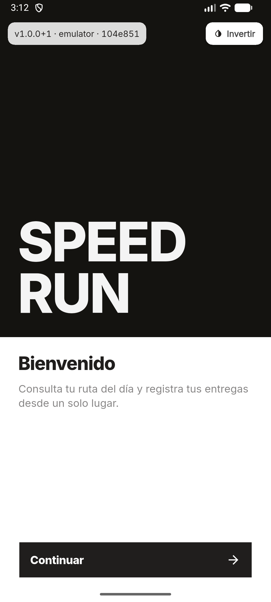
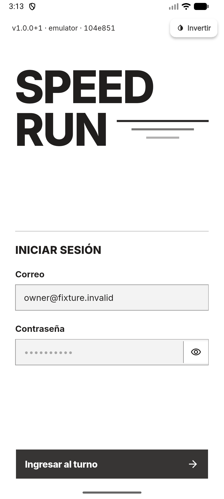
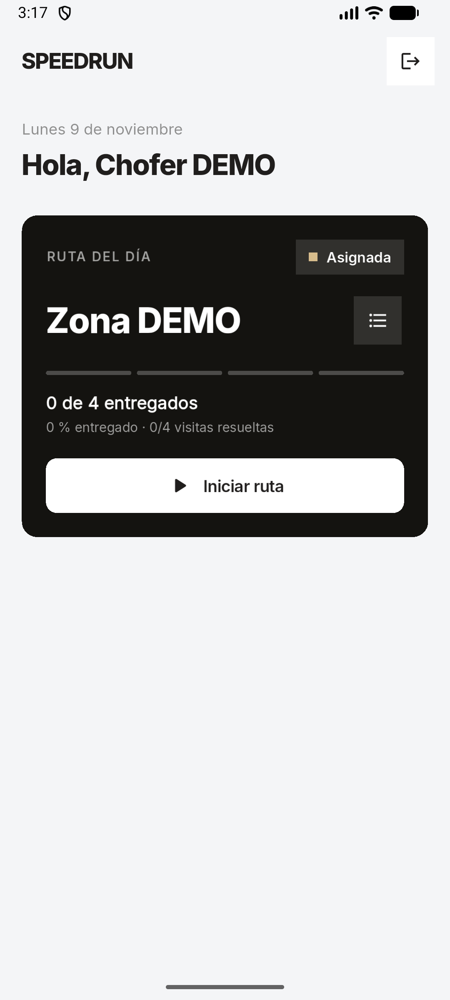
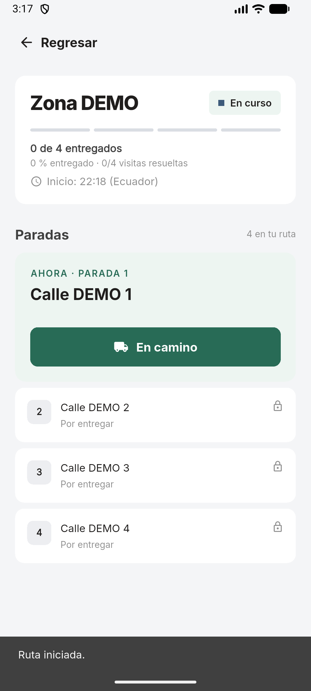
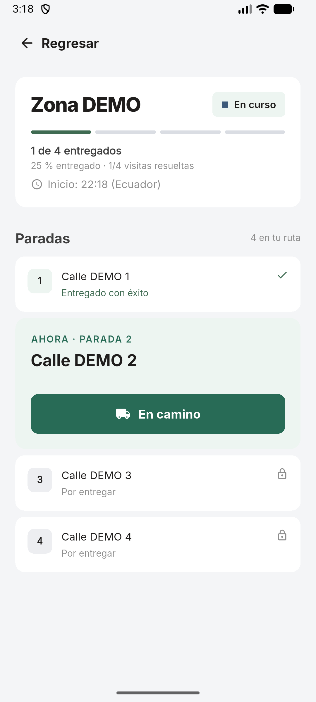
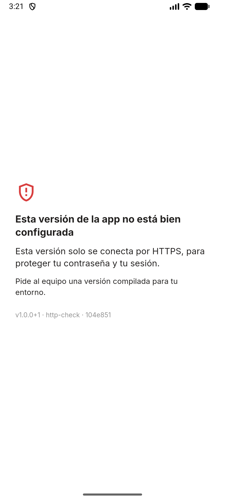
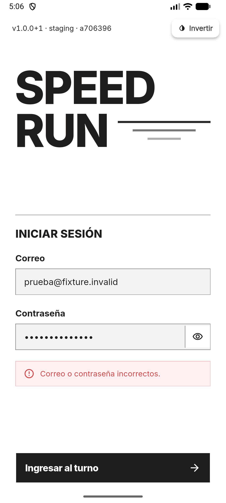

# Issue #6 — APK demostrable y conexión segura al staging

Fecha: 9 de noviembre de 2026 (America/Guayaquil).

## Qué se entrega

- **Configuración por entorno sin URLs fijas.** `API_BASE_URL`, `APP_ENV` y `ALLOW_INSECURE_HTTP` llegan por `--dart-define-from-file=config/<entorno>.json`. Hay ejemplos para emulador, red local y staging; los archivos reales no se versionan.
- **Conexión segura.** Una build release con `http://` sin permiso explícito, con una URL inválida o con credenciales dentro de la URL muestra una pantalla de configuración y no pide la contraseña. El staging solo se compila con HTTPS.
- **APK identificado.** `tool/build_demo_apk.ps1` exige un árbol limpio y nombra el APK con versión, entorno y commit. Genera además el SHA-256 y un archivo con los datos de la build. La app muestra esa identificación en la bienvenida y el login. El nombre visible en Android pasa a «Speedrun».
- **Firma release opcional** con `android/key.properties` (no versionado). Si no existe, se usa la clave debug y el script lo advierte.
- **Documentación**: [guía del APK, guion de la demo, plan alternativo y limitaciones](../../apk-demo.md).

## Pruebas automatizadas

- `flutter pub get`: correcto.
- `flutter analyze`: sin problemas.
- `flutter test`: **132 pruebas aprobadas**, frente a 120 en la base.

Las 12 nuevas pruebas cubren la validación de la URL (HTTPS en release, `http://` solo con permiso o en debug, URLs inválidas, credenciales en la URL, barras finales), la etiqueta de la build, la pantalla de configuración sin campos de login y la etiqueta visible en el login pero no en Mi Ruta.

## APK release en emulador

Resultado: **PASS** en `Medium_Phone_API_36.1` (Android 16, API 36, x86_64). No se declara validación en teléfono físico.

| Dato | Valor |
|---|---|
| Archivo | `speedrun-1.0.0-b1-emulator-104e851.apk` (47,4 MB, release) |
| SHA-256 | `f9e6545f3cae4aa6b0c1eb7dae8feb6c70ec7f42805ca01e8ae947a2ee2d60bd` |
| Commit móvil | `1878964280d5a7c1ae54196c96cad1db8dcc92db` |
| Backend | `2e196400f682cad5107d7d6bc706b50efee1a1e7` (NestJS + PostgreSQL reales, fixture aislada) |
| Flutter | 3.41.3, Dart 3.11.1 |
| Firma | clave debug (no hay `android/key.properties`) |

El nombre del APK y las capturas muestran `104e851`: es el mismo código que `1878964` (árbol `1bd1276`). Solo se corrigió el mensaje del commit antes de subirlo.

Flujo verificado con datos ficticios (`owner@fixture.invalid`): bienvenida con la identificación de la build, login `DRIVER`, Mi Ruta del Día con la ruta asignada, **Iniciar ruta** confirmada por el servidor, **En camino** y **Entregado** en la primera parada (25 % entregado, 1/4 visitas resueltas). PostgreSQL confirma el mismo estado: [postgresql-result.txt](postgresql-result.txt).

| | |
|---|---|
|  |  |
|  |  |
|  |  |

La última captura es un APK release compilado a propósito con `http://` y sin `ALLOW_INSECURE_HTTP`. La app no llega al login y explica que solo se conecta por HTTPS.

El APK de emulador usa `http://10.0.2.2:3003` con `ALLOW_INSECURE_HTTP=true`, porque apunta a la fixture local. Prueba el empaquetado release, la configuración y el flujo, **no** el TLS del staging.

## Staging (Coolify + Cloudflare Tunnel)

Fecha: 17 de noviembre de 2026. API: `https://api-regalia.sjproyects.me/api/v1`. La URL solo vive en `config/staging.json`, que no se versiona.

**Conexión HTTPS: PASS.**

| Dato | Valor |
|---|---|
| Archivo | `speedrun-1.0.0-b1-staging-a706396.apk` (47,4 MB, release) |
| SHA-256 | `93879eff3681cc88611cda9448fada17f99944beb00b2b0b74e84df2f839546e` |
| Commit móvil | `a706396` |
| Firma | clave debug (no hay `android/key.properties`) |
| TLS | TLSv1.3, `TLS_AES_256_GCM_SHA384`, certificado `CN=sjproyects.me` emitido por Google Trust Services (WE1), válido hasta el 22/01/2027, servido por Cloudflare |
| Salud | `GET /api/v1/health` → 200 `{"status":"ok","database":"up"}`; Swagger desactivado (`/api/docs` → 404), como indica el despliegue |

El APK de staging se instaló en el emulador API 36 y mostró la identificación `v1.0.0+1 · staging · a706396`. Un login con una cuenta ficticia inexistente llegó a NestJS por el túnel. El servidor respondió 401 y la app mostró «Correo o contraseña incorrectos.», sin guardar sesión. El emulador sale a internet por la red del PC, **no por datos móviles**.



**Flujo del chofer en staging: pendiente.** El staging no tiene datos de demostración: los usuarios del *seed* (`driver1@delivery.com`) responden 401. Para cerrar el issue hace falta que ADMIN cree desde el panel web un chofer de prueba con una ruta asignada para el día. Luego, con el APK compilado desde `main` (con #6 y #8 fusionados), se repite el guion completo desde un teléfono con datos móviles. No se usaron ni se buscaron credenciales de administración.

**Observación para el backend:** `http://api-regalia.sjproyects.me/api/v1/health` también responde 200 sin redirigir a HTTPS. La app no se ve afectada, porque las builds release solo aceptan `https://`. Aun así, conviene activar «Always Use HTTPS» en Cloudflare para los demás clientes.

Los pasos (c) a (e) del ciclo completo de la adenda los implementa la issue #8. Ver el [guion](../../apk-demo.md#4-guion-de-la-demostración).

## Hallazgo durante la prueba

La base de desarrollo `logistica_db` no tenía aplicadas las últimas migraciones del backend: `prisma db verify` responde `CONTRACT.MARKER_MISMATCH` y falta la columna `order.subtotalCents`. Como la fixture copiaba el esquema de esa base, `GET /drivers/me/routes` fallaba con 500 en cuanto había pedidos. Ahora `tool/daily_route_fixture.mjs` crea el esquema desde el contrato actual del backend (`prisma db init` sobre una base vacía), sin depender del estado de `logistica_db`. La base de desarrollo no se modificó.

## Reproducción en PowerShell

```powershell
# Desde AppRepartidor, con el backend compilado (npm run build) y logistica_postgres en marcha:
node tool/daily_route_fixture.mjs setup ../BackendRepartidor/backend mobile_issue6_prueba_unica
node tool/daily_route_fixture.mjs serve ../BackendRepartidor/backend mobile_issue6_prueba_unica

# En otra terminal:
Copy-Item config/emulator.example.json config/emulator.json
# En config/emulator.json, cambiar el puerto 3000 por 3003 (fixture).
.\tool\build_demo_apk.ps1 -Environment emulator
& C:/Android/Sdk/platform-tools/adb.exe install -r build/demo/<archivo>.apk
# Login: owner@fixture.invalid / fixture-only-123 (solo existe en la base aislada)

# Limpieza:
node tool/daily_route_fixture.mjs cleanup ../BackendRepartidor/backend mobile_issue6_prueba_unica
```
