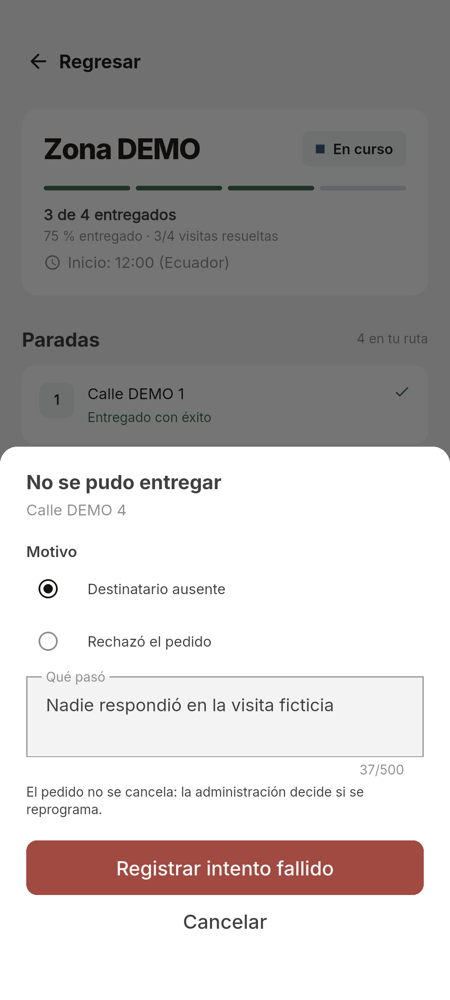
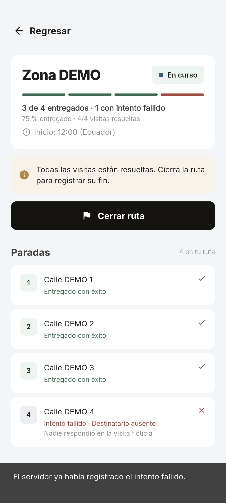
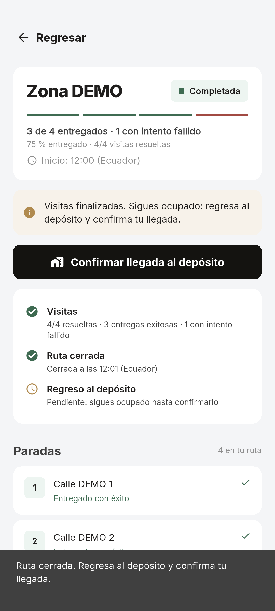
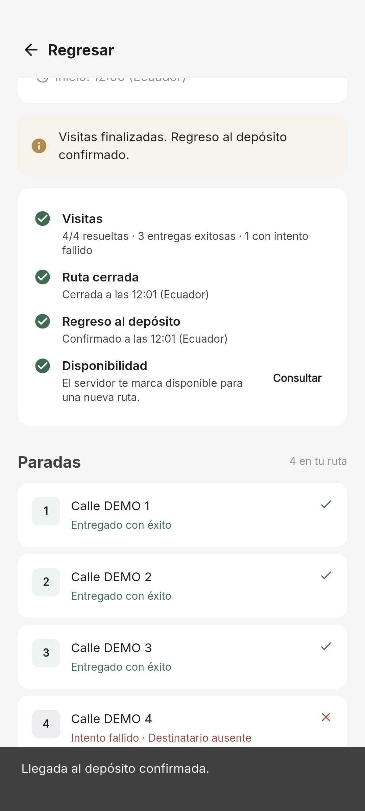

# Issue #8: entrega fallida y regreso al depósito

Fecha: 17 de noviembre de 2026 (America/Guayaquil).

## Comportamiento

**Registrar un intento fallido (unidad A)**

- En una ruta `IN_PROGRESS`, la parada en turno ofrece «No se pudo entregar». La parada debe tener una visita verificada y pendiente, y su pedido debe estar `ASSIGNED` o `IN_TRANSIT`.
- La hoja exige elegir un motivo tipificado («Destinatario ausente» o «Rechazó el pedido») y escribir qué pasó. Esa descripción no puede quedar vacía ni con solo espacios, y admite hasta 500 caracteres.
- La app envía `POST /routes/:id/stops/:stopId/failure` con `{reason, context, requestId}`. El `requestId` es un UUID v4 generado en el teléfono.
- El intento solo se confirma cuando el servidor lo persiste. El pedido conserva su estado comercial: no se envía ni se muestra `CANCELLED` ni `DELIVERED`. La parada muestra «Intento fallido · Destinatario ausente» con la descripción, y el turno pasa a la siguiente parada.
- **Si la respuesta se pierde**, se consulta GET antes de cualquier reintento. Si el servidor ya lo había registrado, la app lo informa sin volver a enviarlo.
- **Si no se persistió**, la hoja recuerda lo escrito. Reenviar exactamente lo mismo reutiliza el mismo `requestId`, que el servidor trata como repetición idempotente. Cambiar el motivo o el texto genera un id nuevo, para no chocar con otra solicitud.
- Los errores 400, 403, 404 y 409 se explican sin anunciar éxito. Un 401 cierra la sesión. El chofer no puede reprogramar, reordenar ni editar paradas: eso lo hace ADMIN.

**Cerrar la ruta y confirmar el regreso (unidad B)**

- **Cierre.** Con todas las visitas resueltas (éxitos o fallos) la ruta sigue «En curso» y la app ofrece «Cerrar ruta». Primero pide confirmación y luego envía `POST /routes/:id/complete` con `{}`. La app no deduce `COMPLETED` contando paradas.
- **Regreso.** Una ruta `COMPLETED` (o `INTERRUPTED` por la administración) sin regreso confirmado muestra «Sigues ocupado» y ofrece «Confirmar llegada al depósito». Envía `POST /routes/:id/return` con `{}` tras confirmar en un diálogo que advierte que la app no verifica la ubicación.
- **Resumen.** El resumen de la ruta separa cuatro pasos: visitas resueltas, ruta cerrada (con hora), regreso al depósito (pendiente o confirmado, con hora) y disponibilidad. La disponibilidad solo aparece con la respuesta persistida del regreso o al tocar «Consultar» (`GET /drivers/me/availability`). Nunca se deduce del estado de la ruta.
- Si se pierde la respuesta del cierre o del regreso, se recupera por GET sin reenviar. Si tampoco se puede consultar, las acciones se bloquean hasta actualizar la lista.
- **Rutas interrumpidas.** Muestran «Interrumpida», el motivo dado por la administración y ninguna acción de parada. Permiten confirmar el regreso. La recuperación de productos la gestiona ADMIN (backend #51).
- **Rutas sin zona.** Los pedidos por cobertura de tienda (backend #41/#42) pueden llegar con `zone: null`. La app las muestra como «Ruta sin zona» en lugar de fallar con «rutas inválidas».
- **Avisos.** Cada aviso nuevo descarta los anteriores que seguían en cola, para que siempre se vea el resultado de la última acción.

No hay GPS, ETA, temporizadores de oferta ni cola de mutaciones sin conexión.

## Pruebas automatizadas

- `flutter pub get`: correcto.
- `flutter analyze`: sin problemas.
- `flutter test`: **171 pruebas aprobadas**, frente a 120 en la base.

Las 51 pruebas nuevas cubren:

- **Modelo:** zona nula, lectura del id de la visita y del motivo, visitas sin verificar o antiguas, cierre y regreso como pasos distintos, ruta interrumpida.
- **Servicio:** rutas y cuerpos enviados, respuestas incompletas o de otra visita, rechazos 400/403/404/409 y timeouts sin reenvío.
- **`requestId`:** formato UUID v4 y unicidad.
- **Pantalla:**
  - Motivo y descripción obligatorios.
  - Cancelar la hoja no envía nada.
  - Respuesta perdida tras persistir.
  - Reintento con el mismo o con otro `requestId`.
  - 403 sin recuperación.
  - Visita sin verificar sin la acción.
  - Cierre con confirmación, cierre rechazado con 409 y bloqueo durante el cierre.
  - Regreso disponible o no disponible, y respuesta de regreso perdida con consulta de disponibilidad.
  - Ruta interrumpida y ruta sin zona.

## Integración Android

Resultado: **PASS**. `flutter drive` terminó con salida 0 en `Medium_Phone_API_36.1` (Android 16, API 36, x86_64), contra NestJS y PostgreSQL reales con datos ficticios. No se declara validación en teléfono físico.

Escenario `integration_test/failed_visit_return_test.dart`:

1. **Rechazos reales del backend:** intento sin JWT (401), chofer ajeno, ADMIN y CLIENT (403 en fallo, cierre y regreso), id de otra ruta (403), y fallo, cierre y regreso antes de iniciar (409).
2. **Entregas y fallo desde la interfaz:** tres entregas completas y luego el intento fallido de la cuarta parada. Su respuesta se pierde **después** del commit; la app la recupera por GET con un único POST y muestra 3 de 4 entregados · 1 con intento fallido, y 75 % · 4/4 visitas resueltas. Sigue «En curso» y el chofer no está disponible.
3. **Cierre de la ruta:** queda «Completada», el chofer sigue ocupado y una visita nueva sobre la ruta cerrada recibe 409.
4. **Regreso:** «Llegada al depósito confirmada» y disponibilidad informada por el servidor. La repetición del regreso es idempotente y conserva la misma hora.

| | |
|---|---|
|  |  |
|  |  |

**Verificación directa en PostgreSQL** ([postgresql-result.txt](postgresql-result.txt), mediante [verify.sql](verify.sql)):

- Ruta `COMPLETED` con cierre y regreso registrados, conductor disponible.
- 3 visitas `SUCCESSFUL` y 1 `FAILED`, cada una con un único intento.
- El pedido fallido sigue `ASSIGNED`, con motivo `RECIPIENT_ABSENT` y `requiresAdministrativeReview = true` para que ADMIN decida.
- Una sola reserva del conductor, liberada.
- La ruta ajena quedó intacta.

Backend validado: `9b17cceaa31bc216ea0ec2f20a9b95188bf82652`. En los módulos que usa la app es igual al `origin/main` desplegado en staging. Base de esta rama móvil: `89f7050`.

## Contrato y límites

- **Contrato.** Se comparó con el código del backend desplegado, porque Swagger está desactivado en el staging: `route-progress.service.ts`, `route-return.service.ts`, `route-lifecycle.policy.ts` y los DTO de historial, regreso y disponibilidad.
- **Disponibilidad.** La que devuelven el regreso y `GET /drivers/me/availability` considera las reservas y la marca de compatibilidad, pero **no las ausencias** del calendario (backend #44): esas solo se evalúan por día dentro del backend. Si un chofer con ausencia confirma su regreso, la app mostrará lo que diga el servidor; la asignación de nuevas rutas la decide ADMIN.
- **Reprogramación.** La reprogramación de pedidos fallidos y la recuperación de productos de una emergencia se hacen en el panel web ADMIN, no desde Flutter.

## Reproducción en PowerShell

```powershell
# Desde AppRepartidor, con el backend compilado (npm run build) y logistica_postgres en marcha:
node tool/daily_route_fixture.mjs setup ../BackendRepartidor/backend mobile_issue8_prueba_unica
node tool/daily_route_fixture.mjs serve ../BackendRepartidor/backend mobile_issue8_prueba_unica

# En otra terminal:
& C:/Android/Sdk/platform-tools/adb.exe -s <device-id> reverse tcp:3003 tcp:3003
flutter drive --driver=test_driver/failed_visit_return_test.dart --target=integration_test/failed_visit_return_test.dart -d <device-id> --dart-define=API_BASE_URL=http://127.0.0.1:3003/api/v1

# Verificación y limpieza:
Get-Content docs/evidence/issue-8/verify.sql | docker exec -i logistica_postgres psql -U logistica_user -d mobile_issue8_prueba_unica
node tool/daily_route_fixture.mjs cleanup ../BackendRepartidor/backend mobile_issue8_prueba_unica
```

La fixture crea su esquema desde el contrato actual del backend (`prisma db init`), sin copiar la base de desarrollo.
